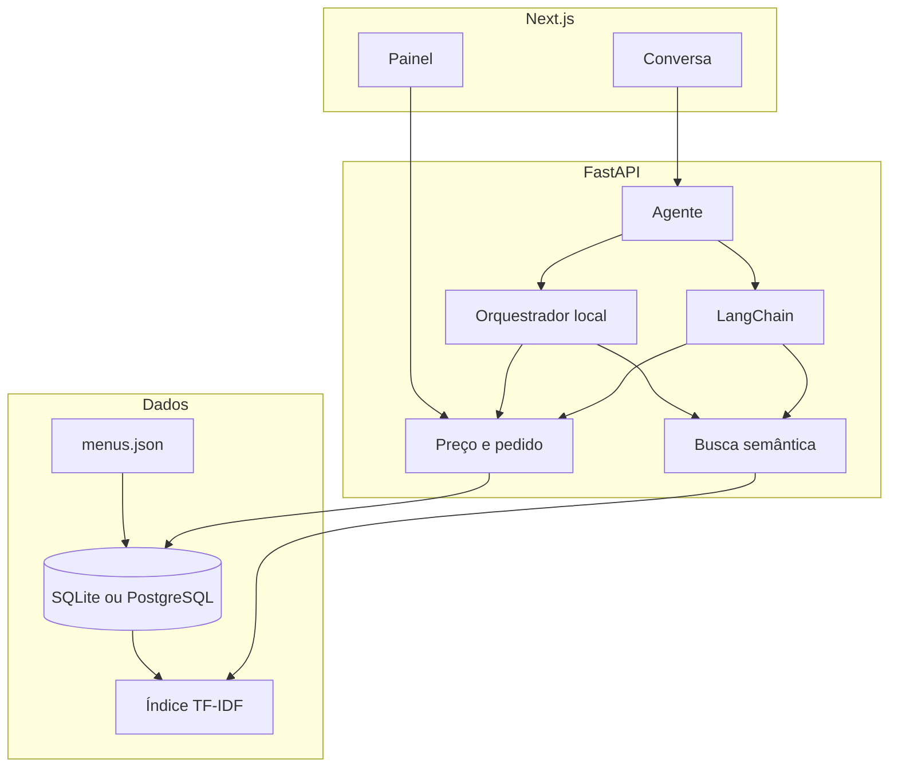

# MenuMatch AI

Agente de recomendação e atendimento de cardápios para delivery. A pessoa descreve o que quer em linguagem natural — restrição, pressa, teto de preço, região — e o sistema devolve pratos do cardápio e um pedido em JSON, com subtotal, taxa de entrega e total.

O repositório sobe sem chave de API. O orquestrador local chama as mesmas ferramentas da versão com LLM. Com `GEMINI_API_KEY` ou `OPENAI_API_KEY`, o atendimento passa a usar tool calling via LangChain e, se o modelo não consultar as ferramentas, a resposta volta para o orquestrador local. test

## Arquitetura



| Módulo | Função |
| --- | --- |
| `backend/app/catalog.py` | Ingestão do JSON para o banco |
| `backend/app/embeddings.py` | Texto do prato e vetor TF-IDF |
| `backend/app/search.py` | Filtros duros e ranqueamento por cosseno |
| `backend/app/intent.py` | Leitura de restrição, preço, tempo e zona |
| `backend/app/pricing.py` | Taxa de entrega e total |
| `backend/app/agent.py` | Orquestração e fallback |
| `backend/app/langchain_agent.py` | Tool calling com Gemini ou GPT |
| `frontend/` | Conversa do cliente e painel do restaurante |

O detalhe do fluxo, da latência e do contrato das ferramentas está em [docs/ARCHITECTURE.md](docs/ARCHITECTURE.md).

## Como rodar

Requisitos: Python 3.11+ e Node 20+.

API:

```powershell
cd backend
python -m venv .venv
.\.venv\Scripts\Activate.ps1
pip install -r requirements.txt
uvicorn app.main:app --reload --port 8000
```

Interface, em outro terminal:

```powershell
cd frontend
npm install
npm run dev
```

Abra `http://localhost:3000`. A documentação interativa da API fica em `http://localhost:8000/docs`.

Testes do motor de busca, do parser e do cálculo:

```powershell
cd backend
pytest
```

## Variáveis de ambiente

Copie `.env.example` para `.env` na raiz.

| Variável | Efeito |
| --- | --- |
| `LLM_PROVIDER` | `auto`, `local`, `gemini` ou `openai` |
| `GEMINI_API_KEY` / `OPENAI_API_KEY` | Liga o tool calling |
| `DATABASE_URL` | SQLite por padrão. Para PostgreSQL, use a URL do SQLAlchemy |
| `CORS_ORIGINS` | Origem do frontend |

Tool calling opcional:

```powershell
pip install -r requirements-llm.txt
```

## O que a demo mostra

- Busca: "Quero algo sem lactose, rápido e por menos de R$ 40".
- Pedido com taxa por região (Centro R$ 5,90, Zona Sul R$ 8,90, e as demais no código).
- Confirmação pela conversa ou pelo botão, gravando a venda.
- Painel com pedidos do dia, ticket, itens mais pedidos e minutos economizados.

A economia de tempo é uma estimativa: 4,2 min navegando o cardápio contra 0,7 min com o agente, multiplicado pelos pedidos de hoje. Os números de venda vêm dos pedidos semeados e dos que você confirmar.

## Trilhas

**AI Engineer.** Backend em módulos, pipeline de ingestão, embeddings com contrato para trocar o provedor, filtros separados do ranqueamento, latência em cada resposta e tool calling com fallback.

**AI Builder.** A conversa e o painel sobem juntos. O problema — achar um prato com restrição, pressa e preço — se resolve numa frase, e o pedido já sai estruturado.

## Produção

O modelo SQLAlchemy usa SQLite ou PostgreSQL conforme `DATABASE_URL`. Os vetores ficam em memória e o manifesto vai para `backend/.cache/index_meta.json`. O script [infra/postgres_pgvector.sql](infra/postgres_pgvector.sql) é o alvo com pgvector, para a mesma busca por cosseno dentro do banco.

Na Vercel, publique a pasta `frontend` e aponte `NEXT_PUBLIC_API_URL` para a API. No Render, o serviço Python usa `backend` como raiz, `pip install -r requirements.txt` no build e `uvicorn app.main:app --host 0.0.0.0 --port $PORT` na subida.
