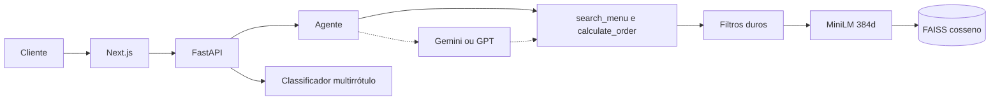

# MenuMatch AI

[](https://www.python.org/)
[](https://fastapi.tiangolo.com/)
[](https://huggingface.co/sentence-transformers/paraphrase-multilingual-MiniLM-L12-v2)
[](https://scikit-learn.org/)
[](https://docs.docker.com/compose/)
[](https://docs.pytest.org/)

Agente de cardápio para delivery. A pessoa descreve restrição, pressa, teto de preço e região em português. O sistema devolve pratos do cardápio e um pedido com subtotal, taxa e total.

## O problema

Um filtro SQL resolve `preco <= 40 AND alergeno <> 'lactose'`. Ele não resolve "almoço leve sem derivados de leite". "Leve" não é coluna. "Derivados de leite" não é o token `lactose`. "Algo que preste para agora" não é um `WHERE`.

O MenuMatch separa as duas coisas. Alergia, dieta, preço, tempo e zona continuam sendo filtro determinístico: um prato com lactose nunca passa numa busca sem lactose. O que sobra é ordenado pela proximidade da frase com o texto do prato. Um classificador à parte lê a descrição e sugere tags nutricionais, sem permissão para afrouxar essa trava.

## Arquitetura



| Módulo | Função |
| --- | --- |
| `backend/app/routes/api.py` | Rotas, validação e erros HTTP |
| `backend/app/tools/menu.py` | Busca e cálculo do pedido, os dois modos do agente |
| `backend/app/services/sentence_embeddings.py` | MiniLM multilíngue em ONNX |
| `backend/app/services/vector_store.py` | `vectors.npy` + `index.faiss` |
| `backend/app/services/classifier.py` | TF-IDF + `MultiOutputClassifier` |
| `backend/app/schemas.py` | Contratos Pydantic |
| `backend/app/search.py` | Filtro e ranqueamento |
| `frontend/` | Conversa e painel |

O detalhe do fluxo está em [docs/ARCHITECTURE.md](docs/ARCHITECTURE.md).

## Embeddings

O modelo padrão é `sentence-transformers/paraphrase-multilingual-MiniLM-L12-v2`, executado pelo fastembed em ONNX (o artefato em cache é a exportação quantizada da mesma família). São 384 dimensões, L2-normalizadas. A distância é cosseno, via produto interno no `IndexFlatIP` do FAISS.

`all-MiniLM-L6-v2` é o checkpoint em inglês da mesma família. Ele cabe no mesmo código (`EMBEDDING_MODEL`), mas o cardápio e o cliente estão em português, então o multilíngue é o padrão. PyTorch ficou de fora: o ONNX sobe num serviço pequeno sem arrastar um runtime de vários gigabytes.

Na subida, os 30 pratos são embedados e o índice vai para `backend/.cache/vectors/`. Se o hash do cardápio e o nome do modelo não mudaram, o processo só relê o arquivo.

Medido nesta máquina, com o modelo já em disco:

| Etapa | Tempo |
| --- | --- |
| Embedar o cardápio inteiro (30 pratos) | 4,2 s, uma vez |
| Relêr o FAISS já gravado | cerca de 2 ms |
| Embedar uma frase | 14 ms |
| Varredura FAISS | 0,03 ms |

Para "almoço leve sem derivados de leite por menos de 40 reais", o topo foi Bowl de Frango & Legumes e Salada de Quinoa, os dois sem lactose e dentro do teto.

`EMBEDDING_PROVIDER=tfidf` volta ao índice esparso antigo, sem download. Os dois espaços não se misturam: a assinatura do arquivo inclui o modelo.

## Classificação multirrótulo

`backend/app/services/classifier.py` treina um `TfidfVectorizer` (unigramas e bigramas) e um `MultiOutputClassifier` de regressão logística nas frases de `backend/app/data/tag_train.json`. As saídas são `vegano`, `vegetariano`, `sem-lactose`, `sem-gluten`, `low-carb` e `proteico`. O limiar é 0,55. `POST /api/classify` devolve as tags e a probabilidade de cada uma.

No conjunto de cinco frases que não entra no treino, a precisão macro foi 0,92 e o recall macro foi 1,00. É um conjunto pequeno, de propósito: o modelo é uma linha de base auditável, não um transformer de tags. Alérgeno publicado no cardápio continua mandando no filtro. A tag predita só acompanha o prato em `predicted_tags`.

## Como rodar

Docker, API e interface:

```powershell
docker compose up --build
```

A conversa abre em `http://localhost:3000`. A API e o `/docs` ficam em `http://localhost:8000`. O primeiro boot baixa o MiniLM para o volume `menu-cache`.

Desenvolvimento local, sem Docker. Python 3.11+ e Node 20+.

```powershell
cd backend
python -m venv .venv
.\.venv\Scripts\Activate.ps1
pip install -r requirements.txt
uvicorn app.main:app --reload --port 8000
```

```powershell
cd frontend
npm install
npm run dev
```

Testes de busca, embeddings, FAISS e classificador:

```powershell
cd backend
pytest
```

Tool calling com Gemini ou GPT:

```powershell
pip install -r requirements-llm.txt
```

Copie `.env.example` para `.env` na raiz. Sem chave, o orquestrador local chama as mesmas ferramentas.

| Variável | Efeito |
| --- | --- |
| `LLM_PROVIDER` | `auto`, `local`, `gemini` ou `openai` |
| `GEMINI_API_KEY` / `OPENAI_API_KEY` | Liga o tool calling |
| `EMBEDDING_PROVIDER` | `minilm` ou `tfidf` |
| `EMBEDDING_MODEL` | Checkpoint Hugging Face usado pelo fastembed |
| `DATABASE_URL` | SQLite por padrão. PostgreSQL pela URL do SQLAlchemy |
| `CORS_ORIGINS` | Origem exata do frontend, com `https` e sem barra no fim |

## O que a demo mostra

- "Quero algo sem lactose, rápido e por menos de R$ 40".
- Pedido com taxa por região (Centro R$ 5,90, Zona Sul R$ 8,90, e as demais no código).
- Confirmação pela conversa ou pelo botão.
- Painel com pedidos do dia, ticket, itens mais pedidos e minutos economizados.

A economia de tempo é uma estimativa: 4,2 min no cardápio contra 0,7 min com o agente, vezes os pedidos de hoje.

## Produção

O banco é SQLite ou PostgreSQL, conforme `DATABASE_URL`. O índice vetorial ativo é FAISS no processo da API. [infra/postgres_pgvector.sql](infra/postgres_pgvector.sql) é o mesmo cosseno dentro do Postgres, coluna `vector(384)` e HNSW.

Na Vercel, publique a pasta `frontend` com `NEXT_PUBLIC_API_URL` apontando para a API. No Render, a raiz é `backend`, o build é `pip install -r requirements.txt -r requirements-llm.txt` e o start é `uvicorn app.main:app --host 0.0.0.0 --port $PORT`. O disco do Render é efêmero: cada boot novo baixa o ONNX de novo. Para pular isso, `EMBEDDING_PROVIDER=tfidf`.

`CORS_ORIGINS` tem de ser a origem exata do site, por exemplo `https://menu-match-ai.vercel.app`.
